# Skyspear

[](https://github.com/kyrokohan/skyspear/actions/workflows/ci.yml)

A block-building game that runs in the terminal, built on [glonk](https://glonk.dev).

**Skyspear is turning into a prehistoric lost world:** cave people among dinosaurs, fire mountains and falling stars. [The design](docs/design.md) says where it is going. This page says what is in the game today: so far the land has turned old, you are a cave person in it, and the first beasts live in it: herds of buglers, flocks of nippers, mossbacks you can tame, quickclaws that hunt by night, and the giants: shieldbrows that guard their young, thornbacks, boulderbacks, cloudgrazers whose steps shake the ground, and the dread, which hunts everything. On the cold steppe go herds of snowtusks, in long hair, and slowclaws, and it has hunters of its own: packs of howlers by night, and the daggercat by day. In the coal swamp a sailjaw lies in a black pool with only its sail out of the water, and sunbacks, slow in the morning, are quick by noon. A fire mountain smokes on the horizon, with hot springs and geysers at its foot and a lava tube in its side, and every few days it erupts. Stars streak the night sky, and now and then one comes down near you and leaves a crater with sky iron in it. Among the stars stands the Skyspear, a comet that grows each night, and on the twelfth it arrives: the Great Fall, and after it the Long Winter, four days of ash, frost and cold. Your tools are of flint and wood, a spear is thrown and a sling throws pebbles, and fire is found, carried and made: a struck tree burns, a torch lights your way, and a hearth cooks. Until now it was called gocraft, and the game as it was then is tagged `v0.1.0`.

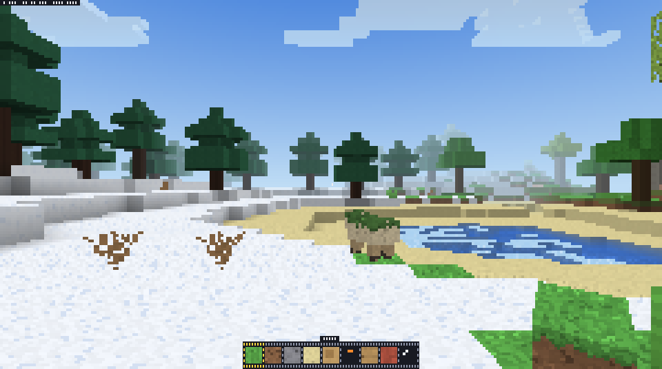

Walk a world with no end, made from a seed, in lands older than grass: a prairie of ferns and horsetails, a jungle of tree ferns, a highland of umbrella pines, gold fan-leaf trees and redwoods, red badlands that rise in mesas, where the skeletons of great beasts lie, and a coal swamp of black pools under scale trees. Tar pits lie in the swamp and the badlands, and hold what walks into them. A journey from where you begin stands a fire mountain, with a lake of lava in its crater: its smoke is on the horizon from the first morning. Round them are seas and shores, a cold steppe of snow, tussocks and dwarf trees, and bare crags, with caves and ores under them, drifting clouds over them, mossbacks grazing on the moss, and herds of buglers that call to each other through the crests on their heads. The sun crosses the sky and sets, the stars come out, and the caves are dark until you bring a torch: in survival, quickclaws come out in the dark and hunt you, and only light holds them off. You are a cave person, seen through your own eyes or from behind your shoulder. Play it in survival, where you dig what you need, carry it, eat and stay alive, or in creative, with every block and nothing to fear. Break blocks and place your own, with the keys or the mouse, look round by dragging, and find the world as you left it the next time. The art and the sounds are original, and made by code in this repo.

## Install and run

```
go install github.com/kyrokohan/skyspear@latest
skyspear
```

Or from a clone of this repo, `go run .`. Requires Go 1.27.2 or newer. The pictures and the sounds are built into the program, so it runs from any folder.

The game as it was under its old name still installs, as `gocraft`: `go install github.com/kyrokohan/gocraft@v0.1.0`.

- **Use a terminal that reports key releases:** Ghostty, kitty, WezTerm, foot, iTerm2 or Alacritty. There you can walk and turn at once. In other terminals (Apple's Terminal, for one) only one key stays held at a time, which is playable but clumsy, and the game says so on screen. This is how glonk reads keys; see its README.
- **A bigger window is a sharper picture.** Every cell is two pixels, one above the other, so 200 by 60 cells is a picture of 200 by 120 pixels.
- **True color looks best.** Inside tmux or over ssh, `export COLORTERM=truecolor` if your terminal can show it.

## Keys and mouse

| Keys | Action |
|---|---|
| W A S D | walk, strafe |
| Arrows | look |
| Space | jump; swim up; rise when flying |
| X | sink when flying |
| F | flying on and off, in creative |
| C | crouch, and stand again: slow, low and quiet |
| V | the view: through your eyes, or from behind your shoulder |
| L | the next of six looks for your body |
| Q / E | break / place the block aimed at (hold to go on); hit / shear a creature aimed at; E with food in hand eats it; E on a clay pot or a hearth opens it, on a fur bed lies down, and on a fire lights the unlit torches in your hand; hold E with a fire drill on a hearth to light it |
| R | throw the spear in your hand, or with a sling in your hand a pebble (hold to go on) |
| 1 to 9, Tab | pick a slot of the hotbar; the next one |
| I | your things: move them between the hotbar and the pack, and make things from them (in creative: every block) |
| T | move the clock on six hours |
| F3 | frame numbers: where the time of a frame goes and how much is sent, the seed, the day and the hour, the days until the comet arrives and until a star next falls near you, and within 300 blocks of a fire mountain the days until it next erupts |
| Esc | pause menu, with these keys on it; on a menu, back |

| Mouse | Action |
|---|---|
| Move | aim at the block under the pointer |
| Hold left and drag | turn the view |
| Left click / right click | break / place (hold still to go on); hit / shear a creature |
| Wheel | pick a slot |
| Click a hotbar slot | pick that slot |
| Click in the bag (I) | take what is in a slot, or put down what you hold; make a line of the list |
| Move and click on a menu | pick a line and choose it |

- **Whichever you used last aims.** Move or click the mouse and the pointer aims. Press an arrow key and the middle of the view aims again, with its crosshair.
- **Drag to look.** A terminal reports the pointer in cells and cannot lock it, so the view cannot follow the mouse as it does in a window. Holding the left button and dragging turns it, a cell at a time; a press let go where it is stays a click. The arrows turn it too.
- While the game runs, the terminal cannot select text with the mouse. `-mouse=false` gives the pointer back to it.
- Letters work in either case, and Ctrl-C quits (and saves).

## Survival and creative

**New world** asks how the world is played, and the world keeps that.

- **Survival.** You start with nothing. A block takes time to dig, from a fifth of a second for leaves to five seconds for stone by hand, and cracks show as you dig. Let go, or look away, and it starts again. A broken block drops as a small block of itself (stone as cobble, mossy earth as dirt, a bush as berries, a fern as fiber, a flint seam as flint, and one block of gravel in eight as a flint; leaves crumble away), which you pick up by walking near. You carry 9 slots on the hotbar and 27 in the pack, 64 of a kind to a slot, and placing a block uses one up.
- **Your body.** Health, food and air show over the hotbar. A fall of more than three blocks hurts, a point for each block more, but not into water. Under water your air lasts 15 seconds, then you drown, slowly. Food goes down a point every 30 seconds; while it is 18 or more of 20 you heal, and at none hunger hurts, though it cannot kill. Berries from bushes, fruit from now and then a leaf, and meat are food. Standing in a fire hurts, 2 points a second. Warmth is a fourth bar, over your health, that shows only when you have lost some: the cold takes it, and a fire gives it back.
- **Making things.** The I screen lists what you can make, beside your slots: Right from the last column goes into the list, and Enter or a click makes one. A line is dim while you lack something for it, and what a line needs shows under the slots. By hand you make four sticks from a log, a cord from three fibers, a knapping stone from four cobble, a digging stick (2 sticks), a club (a log), a spear (3 sticks), a fur bed (3 hides and 6 moss), a hearth (8 cobble), a fire drill (a stick, a log and a cord), two unlit torches (a stick and resin), a soft pot (4 clay), a sling (2 cords and a hide), four pebbles (a block of gravel) and two pit covers (2 sticks and 2 fibers). Stand within four blocks of a knapping stone to knap flint: a hand axe (2 flint), a flint knife (a flint, a stick and a cord) and a flint pick (3 flint, 2 sticks and a cord). Planks, the workbench, the kiln, the crate, torches of coal and the tools of copper and iron can no longer be made; a world that has them keeps them.
- **Fire is found.** Here and there stands a tree that lightning struck: a charred trunk that burns at its top, with a limb that fell from it burning at its foot. Its smoke stands nine blocks over it by day, and its fire shows at night. No hand breaks a fire, and no block takes its place: it goes when the log it burns on is broken. A charred log leaves coal.
- **Fire is made.** A hearth is a ring of stones. Put wood or coal in it, then hold E on it with a fire drill for six seconds, or press E on it with a lit torch. A fire drill lights twelve fires.
- **A hearth burns and cooks.** E on a hearth opens its three slots over yours: what to cook, its fuel, and what it has made. Lit, it burns its fuel a piece after another whether it cooks or not, and goes cold when the fuel is gone: a stick lasts 15 seconds, a log 80, coal 160 and peat 240. While it burns it gives light, smokes, and cooks a piece in six seconds: raw meat to cooked meat (12 points of food, against 5 raw), the seeds of a stump palm to roast seeds, a spear to a hardened spear (it hits for 4 and lasts 150 uses), a soft pot to a clay pot, and clay to brick. A hearth goes on burning when you leave it, wherever it is.
- **Torches.** E on any fire, a lit hearth or a torch that stands lights the unlit torches in your hand. A lit torch in your hand lights the ground round you as you walk, and quickclaws keep out of that light as they do any. It burns for five minutes in the hand, in survival, and then it is a stick again. Set down, a torch burns for ever.
- **Resin and seeds.** One pine or redwood log in five leaves a piece of resin with the log. The crown of a stump palm leaves two seeds: raw they are poison, 4 points of health for 2 of food, and roast they are 6 points of food.
- **A clay pot keeps things.** E on a clay pot opens its 18 slots over yours. What is in a pot or a hearth falls out when you break it.
- **A fur bed** lies flat on the ground. E on one makes it where you wake, after a faint too. At night it also sleeps you through to the morning, unless a hunter is within eight blocks. A broken bed is forgotten, and you wake where you first began.
- **Tools.** The right tool digs its blocks faster: a pick stone and ore, an axe wood, a shovel earth, sand and snow. A digging stick is a shovel of wood, twice as fast as a hand, and a hand axe and a flint pick are three times as fast, an obsidian pick four, and a pick or an axe of sky iron six. Stone, cobble and flint seams break by hand and leave what they hold; coal leaves nothing without a flint pick, and crystal nothing yet. A tool wears by a block broken or a beast hit, a bar on its slot shows what is left, and it is gone when it is worn out: a hand axe after 60, flint on a handle after 130, obsidian after 40, and sky iron after 400. Tools are one to a slot.
- **Weapons.** A hand hits for 1 point and a tool for 2. A club hits for 4 and knocks a beast nearly twice as far back. A spear hits for 3 and reaches a beast a block farther than anything else does. A flint knife hits for 4, and a kill made with it leaves one more piece of meat and always a hide.
- **Hides.** A bugler or a quickclaw leaves a hide when it dies.
- **Beasts.** A beast in front of a block is aimed at before it. Q or a click hits it, again every third of a second while held, and knocks it back. A blade hits hardest, from 3 points in wood to 6 in iron, any other tool 2 and a hand 1; a hit wears the tool in hand.
- **Mossbacks** graze alone on the moss. One cannot be hurt: it runs. E on a mossback shears its moss, which grows back in five minutes, with anything in hand but food.
- **Taming.** E on a mossback with berries or fruit in hand feeds it. After three meals it trusts you: it follows you, runs to catch up when it falls behind, and stands by you when you stand. A tame mossback is kept with the world however far you leave it, and takes no wild one's place.
- **Nippers** are the size of a hen and go in flocks of three to five on the prairie and in the jungle. Come within five blocks and the flock scatters. Stand near with food in your hand and one darts in from up to nine blocks, takes a piece and runs. A nipper has 3 points of health and leaves one piece of meat.
- **Buglers** go in herds of five to eight on the prairie and in the highland, three blocks tall, with their young, half as big, in the middle. A herd keeps together. Come within nine blocks of one, or within four crouched, and it gives its alarm and the whole herd runs from you, faster than you can. A running bugler that runs you down takes 3 points and throws you. A bugler has 16 points of health and keeps its hurts, and the herd runs each time you hit one.
- **The fire mountain.** 500 to 800 blocks from where a world begins stands a cone of dark rock 80 blocks across and about 40 over the land, with a crater at its top. Others lie one to every square of 1,600 blocks.
  - **You find it by its smoke.** From up to 1,200 blocks off a dark column stands in the sky in the way to it by day, and a red glow by night. It is drawn by the sky, so it shows far beyond the 64 blocks the land is drawn to, and it is fainter the farther off you are.
  - **Ashlands** lie round it, out to 70 blocks from its middle: grey ash, dark rock and a charred trunk here and there. Nothing grows there and no beast lives there.
  - **Lava** fills the crater to four blocks under the rim. It glows as fire does. You sink and swim in it as in water, it takes 6 points a second, three times what a fire takes, and the walls of the crater are too high to climb out by. What falls in it is burnt up. A torch can be lit at it. It cannot be broken or carried, and beasts keep out of it.
  - The crater smokes: great puffs that stand nine blocks over it.
  - **Obsidian** runs in black veins on the cone, more of them toward the top, and nowhere else in the world. A flint pick breaks it out.
  - **Firestone** lies in a ring at the rim of the crater, within three blocks of it: lumps the color of brass in the dark rock. It breaks by hand.
  - **Hot springs** lie on the ash 50 to 60 blocks from the middle of the mountain, three or four to a mountain: a pool of warm water one block deep, in rings of rust, gold and green stone. Stand in one and you heal twice as fast, if you have eaten enough to heal at all.
  - **Geysers** stand in the middle of some pools: the first of a mountain's springs always has one. Every 30 seconds a geyser spouts water and steam for three seconds, and the ground trembles for two seconds before. Stand on it when it goes and it throws you about twelve blocks up: come down in the pool and the fall does not hurt. Each goes at its own moment.
  - **It erupts,** every four to seven days, on days the seed gives it, and each mountain on its own. You know of it only within 300 blocks of the crater.
    - **A minute of warning.** The ground trembles, more and more, the mountain rumbles, and every beast within 100 blocks of the crater runs from it.
    - **Then a minute and a half of burning rocks.** One leaves the crater every three quarters of a second, arcs high with a trail of fire, and comes down on the ash, 14 to 64 blocks from the middle. One that hits you or a beast takes 10 points. A roof stops one: the lava tube is shelter.
    - **Where a rock comes down** it leaves a block of dark rock, or one time in four of obsidian, with a fire on it that burns out in a minute. In water or lava it leaves nothing.
    - **No rock comes down within 24 blocks of your bed.**
    - **Ash darkens the sky** from the first rock, and thins for half a day after the last: the light of day is down to a little over half under the most of it, which is still day to a quickclaw. From 200 to 300 blocks off you get less of the ash and of the tremor.
    - From far off the foot of the mountain's smoke is red by day, as it is by night.
  - **A lava tube** runs level into the side of the cone, two blocks wide and three high, lit by lava that still hangs in its roof. 23 blocks in is a chamber with a pool of lava in its floor, and obsidian and firestone in its walls. The dread is too big to follow you in.
- **Falling stars.** A few shooting stars a minute streak the night sky. About one night in three, at a moment in the dark that the seed picks, one comes down near you.
  - **A fireball crosses the sky** for four seconds, with its tail behind it, and the night under it is as bright as dusk. The sky draws it, so you see it from farther off than the land is drawn.
  - **It strikes 40 to 90 blocks from you,** or a little farther if a hill is in its way, on dry land. You see the flash at once. The boom comes a second later for each 40 blocks, so you can count how far, and the ground shakes with it.
  - **Never near what must be kept:** not within 24 blocks of your bed, nor within eight of a pot or a hearth, nor on a fire mountain. One that would come down there burns up: a flash and a boom, and no crater.
  - **It leaves a crater,** a bowl seven blocks across and three deep. What stood over it is gone. Its floor is burnt to dark rock, and where the ground was sand the bowl and its rim are glass. A beast or a person in it when it strikes loses 12 points.
  - **Five fires burn round it for a day.** This is fire you can find: light a torch at one and carry it home.
  - **Under the middle lies the core, of sky iron.** For two minutes it glows, burns you if you stand on it, 2 points a second, and nothing breaks it. Then it is dark, and a flint pick breaks it out, in four seconds: two to four lumps of sky iron.
  - **In the three nights before the Skyspear arrives a star falls near you every night,** and shooting stars come thicker each night as it nears: five a minute on the first night, 26 on the eleventh.
  - A star whose moment passes while you sleep does not fall. One whose moment the T key moves the clock past still falls, if it is night.
- **The Skyspear** is a comet, in the night sky from the first night: a bright head with a tail of light behind it.
  - **It grows each night.** On the first night it is a speck. By the eleventh its tail crosses a third of the sky.
  - **It is fixed among the stars and turns with them:** it rises at dusk lying along the horizon, stands upright at midnight, and sets at dawn. A near one shows through the dusk and the dawn, before the stars do. Ash hides it.
  - **It arrives at the midnight of night 12,** two hours of play, and a new one every 24 days after. On its last evening the low sky is red and its tail is the color of fire.
- **The Great Fall** is the night it arrives.
  - **For three minutes round midnight stars come down thick:** one every two seconds, anywhere within 96 blocks of you, each with its fireball, its flash, its boom and its crater. Two or three are in the sky at once, and the land is as bright as dusk all through.
  - **One can strike where you stand,** which a lone star never does: 12 points. Your bed keeps them off, by 24 blocks, and so do a pot and a hearth, by eight.
  - **Shelter is three blocks of earth or stone over your head:** a cave, a lava tube, a cellar. A star that strikes over you breaks the roof open and does not hurt you, and its core lies in your floor. Leaves and wood do not stop a star, and a hut on the ground is no shelter.
  - **Beasts run** from where a star strikes, from 40 blocks.
  - **Nobody sleeps that night:** a bed will not take you until it is over.
  - **Then the Skyspear itself strikes, far off.** The sky goes white for three seconds. Twenty seconds later its boom comes and the ground shakes hard for six. It does not hurt you.
  - **Ash climbs the sky** in the minute after, and stays for four days: the light of day is down by a third. Then it thins for half a day.
  - **It leaves the land round you full of craters,** dozens of them, each with its core of sky iron.
- **The Long Winter** is the four days after the Skyspear strikes. Then comes spring, and the next comet is a speck in the sky.
  - **Every land is cold,** as the steppe and the crags are at any time.
  - **The cold takes your warmth:** all of it in two minutes, with no fire and no furs. With none left you lose a point of health every four seconds, you do not mend however well fed, and the cold can make you faint.
  - **A fire gives it back,** all of it in 20 seconds, within six blocks: a fire, a hearth that burns, a torch that stands, lava, the hot core of a star. So does the water of a hot spring. Out of the cold it comes back by itself, in 40 seconds.
  - **A fur cloak** is four hides and two cords, made by hand. It works while you carry it: there is nowhere to put it on. With it you lose no warmth by day, and half as fast by night. So furs make the day safe, and the night still needs a fire.
  - **Frost whitens the open ground** and the tops of the trees, in the first minutes, and goes with the ash. It is paint: no block is changed, and under a roof or thick leaves the ground is as it was.
  - **Herds are thin:** half as many of the beasts that live in a land are about, but never fewer than go together.
  - **Hunters are bold:** the ashen day is no light to a quickclaw, so they come at noon as at midnight. A fire's light still holds them off.
- **Tools of obsidian** are knapped at a knapping stone, as flint is. They hit hardest and dig fastest, and are worn out after 40 uses, where flint on a handle lasts 130.
  - An obsidian knife (an obsidian, a stick and a cord) hits for 5 and carves a kill.
  - An obsidian pick (3 obsidian, 2 sticks and a cord) digs four times as fast as a hand, and is the one tool that breaks out crystal. Crystal shards have no use yet.
  - An obsidian spear (an obsidian, 3 sticks and a cord) hits for 5, reaches a block farther, and takes 7 thrown.
- **Tools of sky iron** are hammered cold at a knapping stone. They are the strongest there are and last longest, 400 uses, where obsidian lasts 40.
  - A sky iron knife (a lump, a stick and a cord) hits for 6 and carves a kill.
  - A sky iron pick and a sky iron axe (3 lumps, 2 sticks and a cord each) work six times as fast as a hand.
  - A sky iron spear (a lump, 3 sticks and a cord) hits for 6, reaches a block farther, and takes 8 thrown.
  - The four tools take eight lumps, and a crater holds two to four.
- **A striker** is a flint and a firestone, made by hand. E with it on a hearth that has fuel lights it at once, where a fire drill takes six seconds. E with it anywhere else lights the first unlit torches you carry, with no fire near. It lasts 30 fires.

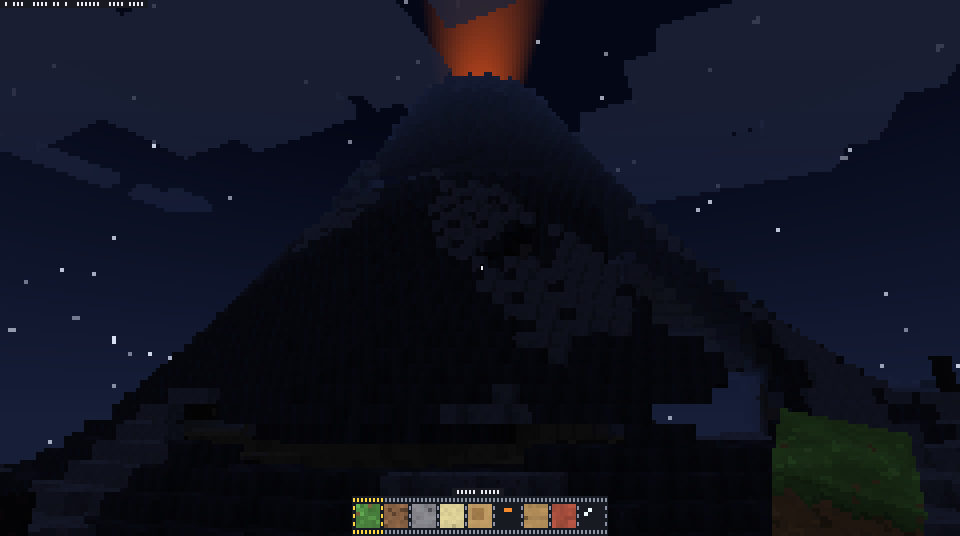

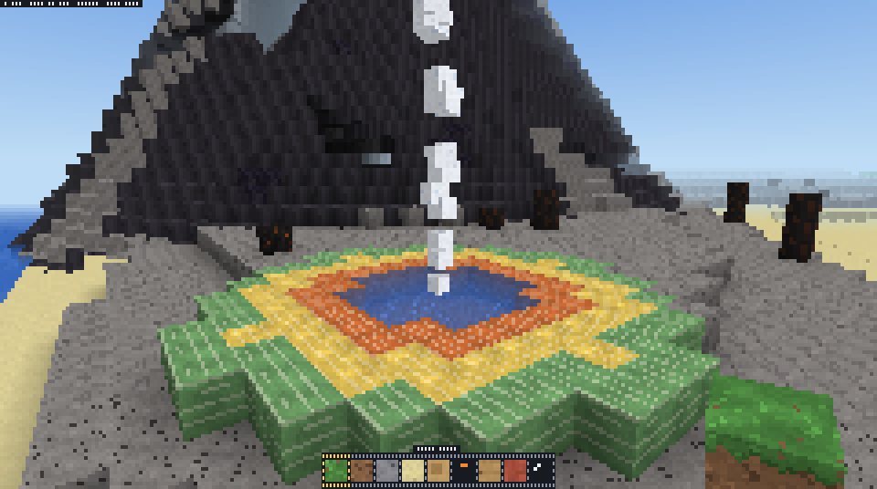

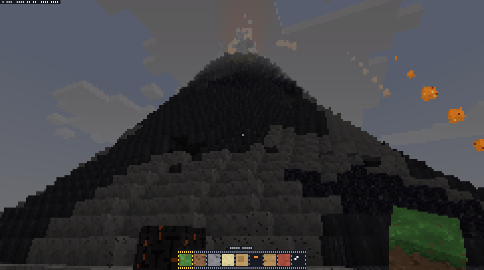

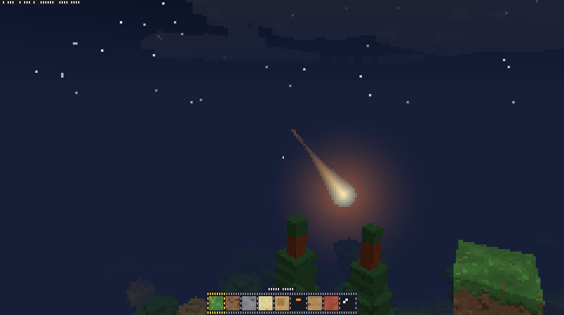

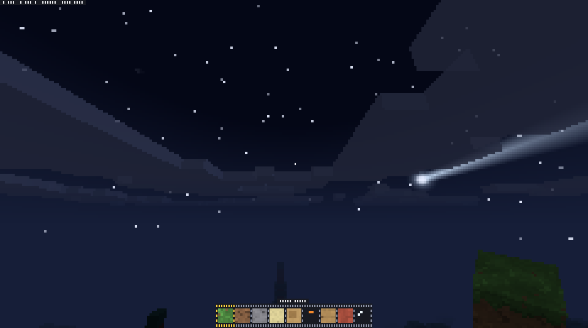

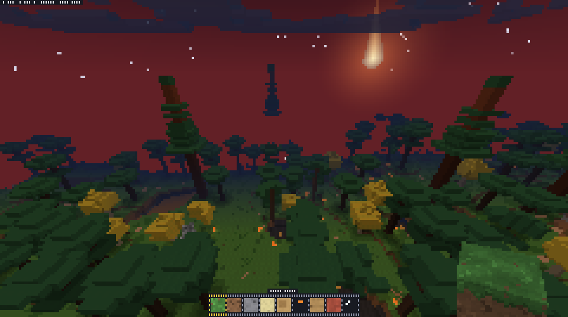

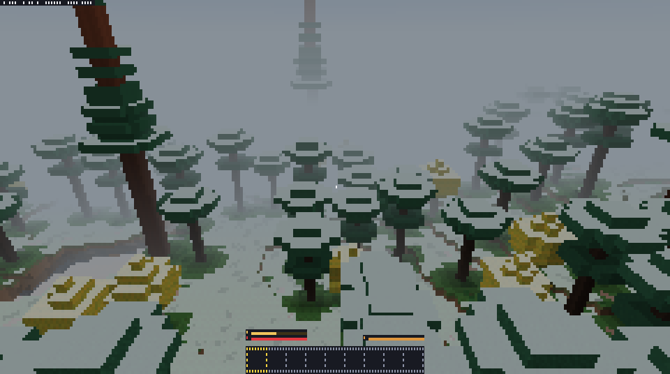

- **Giants that stand their ground.** Three armed plant-eaters do not run from you. Each is few, strong and worth a great deal of meat, and each can be killed, with work. A giant is met by a spear or a hand all along its body, climbs a step of two blocks, and is too heavy for a hit to knock back.
  - **Shieldbrows** are horned, with a shield of bone behind the head, and go as a family on the prairie: two grown and one or two young. Come within ten blocks of a young one and a grown one turns on you, lowers its head and bellows. Come within six, or hit one of the family, and it charges at 7 blocks a second: 6 points, and you are thrown. It cannot turn fast, so something solid between you saves you. Then it goes back to its young. It charges a quickclaw the same way. 60 points of health, 8 pieces of meat and 3 hides.
  - **Thornbacks** carry plates along the back and four spikes on the tail, and go alone in the highland and the jungle. Within six blocks of one it rattles and turns its tail to you; within reach of the tail it strikes, every second and a half: 5 points, and you are thrown. 45 points of health, 6 pieces of meat and 2 hides.
  - **Boulderbacks** are low, slow and armored, with a club at the end of the tail, and go alone in the badlands. The armor takes 3 points off every hit: a hand or a stab does nothing, a club 1, a thrown spear 2 and a thrown hardened spear 3. The club strikes for 7. 50 points of health, 6 pieces of meat and 2 hides.

  - **Cloudgrazers** are the giants among them: a long neck that reaches 13 blocks up, a tail as long, 20 blocks from nose to tail. They go in pairs on the prairie and the shore, slowly, walk through the leaves of trees, and take no notice of you. One cannot be hurt and does not run: a spear thrown at it lies where it fell. Keep out from under it: a foot that comes down on you takes 8 points and throws you aside.
- **The coal swamp** is low wet country that the water has soaked flat, a step or two over the sea. It is about one part in 25 of the world.
  - **Its ground is peat,** black and wet. A digging stick digs it, and a piece burns in a hearth for 240 seconds, three times as long as a log. Coal lies in seams two blocks under the top of it.
  - **Its pools are black:** still water, one or two deep, that stands to the level of the sea, between banks of peat. Look for a sail before you wade into one.
  - **Scale trees** stand on the banks: a bare trunk 8 to 12 blocks tall, all diamonds where old leaves grew, with a small crown at the top. The trunk is a log like any other. One block of trunk in twelve also leaves a piece of amber. Amber has no use yet.
  - Giant horsetails stand two and three blocks tall, with ferns and mushrooms between them.
  - **Rattlewings** are dragonflies as long as your arm, in ones and twos. They are the first thing that flies: one keeps a block and a half over the ground or the water, hangs in the air, darts off some new way, and never comes down. Its wings whirr. It does no harm. A hand's hit sends it off, and a spear's kills it.
  - **Logcrawlers** creep on the peat, alone: two blocks long, low, in red plates, on many legs. They do no harm and keep out of the water. Hit one and it curls up, both ends over its middle, for six seconds: curled, nothing hurts it. 8 points of health, 2 pieces of meat.
  - **Sunbacks** hunt the swamp and the badlands by day, alone, from the third day: as long as you are tall, low, with a sail the color of fire on the back. **The sun warms one.** At noon it runs 6 blocks a second, faster than you walk. At sunrise and at sunset it has four tenths of that, and you walk away from it. It outruns you through the middle two thirds of the day. In the Long Winter there is no sun, and it is slow all day. In the dark it lies still. 35 points of health, a bite of 6, 4 pieces of meat and 2 hides.
  - **Sailjaws** lie in the pools of the swamp and in still shallows by the swamp and the jungle, one in a place: twice a sunback every way, with jaws as long as you are tall. One lies at the top of the water with its back under it, and **only its sail stands out.** Under the water it is a dim shape. From more than seven blocks it takes no notice of you. From the second night on, come within five and it lunges, out of the water if it must: 9 points. Two steps to a side save you from a lunge, and on land it is slower than you. It follows no more than ten blocks from where it lay, and then goes back to its water. 60 points of health, 6 pieces of meat and 3 hides.
- **Tar pits** lie in the swamp and the badlands, where the seed puts them: a round black pool six to ten blocks across and three deep, level with the ground, with the bones of what it caught standing out of it.
  - **Tar holds you.** In it you crawl, at a fifth of a walk, and you sink, 0.08 blocks a second, whatever you do: a jump does not lift you. Your head is under in about twenty seconds, and then your air goes as it does in water.
  - **At the edge you climb out:** walk into the bank and you go up it. From the middle of the widest pit that is six seconds of crawling.
  - **A beast is held for good.** Tar looks like ground to it. Once in, it goes nowhere, sinks, and dies there in a minute, however strong: lead a hunter across a pit, or drive a giant in. A beast that nothing kills, a mossback or a cloudgrazer, knows tar and keeps out of it. What flies goes over it.
  - **Tar comes away in the hand,** a block at a time, and can be put down again where you like. A stick and a piece of tar make two unlit torches, as a stick and resin do.
- **The steppe** is the cold land: snow, tussocks of dry grass through it, and a few trees no taller than five blocks. It takes your warmth at any time of the world. Its beasts stand on the snow.
  - **Snowtusks** go in herds of three to five: three grown, five blocks tall, in long red hair, with a trunk and two tusks, and their young between them. Come within ten blocks of a young one and the grown ones turn on you, lower their heads and trumpet. Come within six, or hit one of the herd, and they charge, together: 7 points each, and you are thrown. 80 points of health, 10 pieces of meat, 4 hides, which is a fur cloak, and from a grown one two tusks. Tusks have no use yet.
  - **Slowclaws** go alone, slow and shaggy, with long arms that end in claws. One takes no notice of you, however near. When it stops it stands up on its hind legs, three blocks tall, as it does to feed from a tree. Hit it and it stands up and comes at where you were, slowly: 6 points. Step away and it does not follow. 40 points of health, 6 pieces of meat and 3 hides.
  - **Howlers** hunt the steppe by night, in packs of four to six, from the second night. They come only to one who is on the steppe. You hear the howl first, from 48 blocks off, and eight seconds later the pack comes out where it howled. They are quicker than quickclaws and more of them: 12 points of health each, a bite of 3. They hunt the herds as well as you. Light holds them off, as it does quickclaws: a torch in your hand is enough.
  - **The daggercat** lives on the steppe, one in a place, and hunts by day. It sees you from 26 blocks and comes on at a walk, low. From eight blocks it snarls and springs, faster than you can run: 10 points, half of all you have. Then it backs off for three seconds and comes again. A spring goes where you stood when it began, so two steps to a side save you. It lies still in the dark. It will not come within twelve blocks of you while you are by a fire. 30 points of health, 3 pieces of meat and 2 hides.
- **The ground shakes.** Each step of a cloudgrazer is a thud heard from 90 blocks off, and within 40 your view shakes with it: a little from far, hard from five blocks. `Ground shake` in the settings turns the shaking off and leaves the sound.

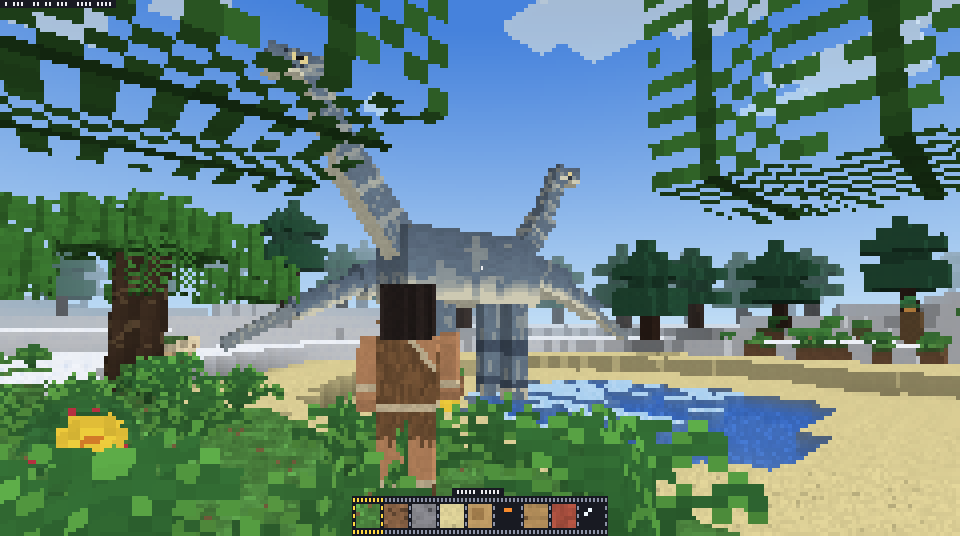

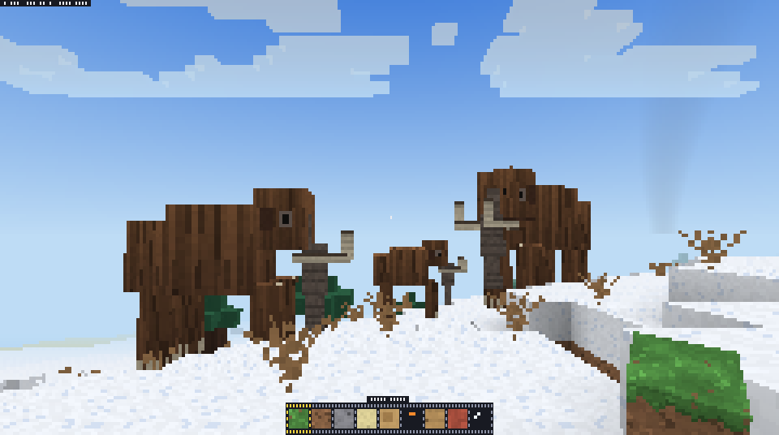

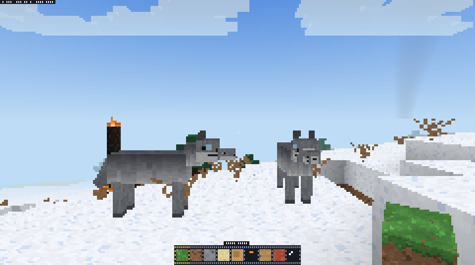

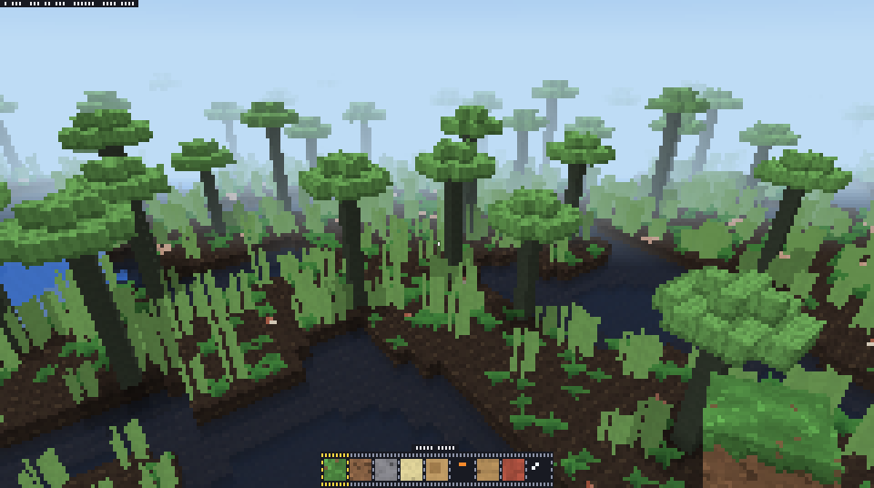

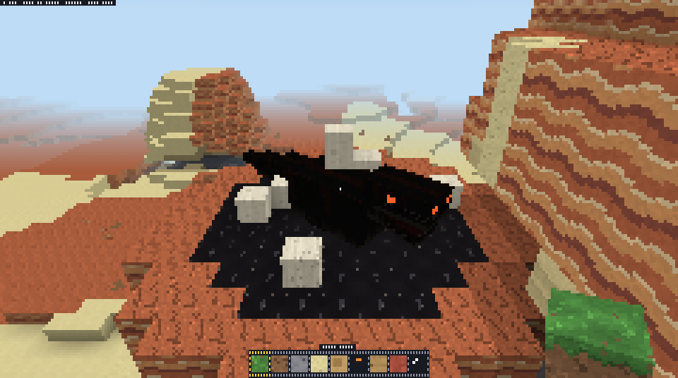

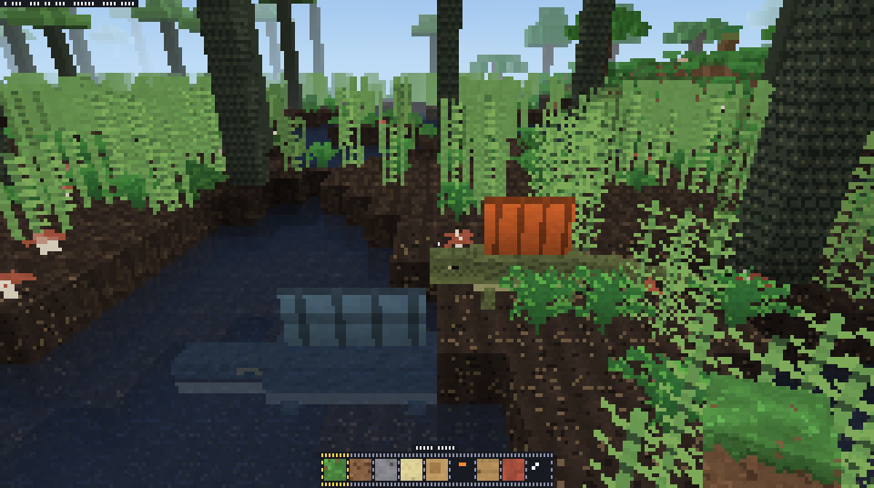

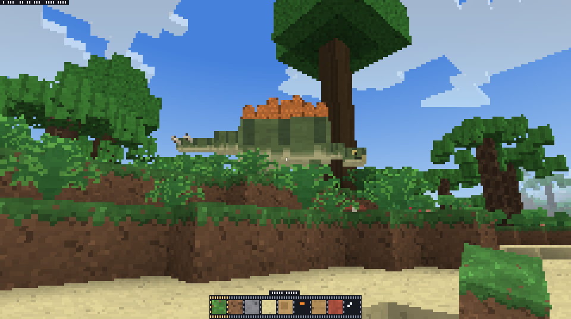

- **Throwing.** R throws the spear in your hand the way you aim. It leaves at 24 blocks a second and falls as it flies, so it comes down some ten blocks off thrown level, and 36 at the most; aim up for a far throw. It takes 2 points more from a beast than a stab does, 5 for a spear and 6 for a hardened one, and the beast's herd runs. A spear that misses sticks in the block it meets, pointing as it flew, until you walk up and take it; one that hits lies by the beast. A throw is a use, and a spear on its last breaks where it lands.
- **A sling** throws a pebble of those you carry, at 38 blocks a second, about every half second while R is held: 100 blocks at the most. A pebble takes 1 point, and a herd takes alarm when one lands within eight blocks of it, hit or not, so a herd can be driven from far off. The pebble lies where it landed. A sling lasts 80 shots.
- **Meat.** A beast that dies sinks, fades and leaves raw meat: a bugler three pieces. Raw meat is food, 5 points a piece, and 12 once a hearth has cooked it.

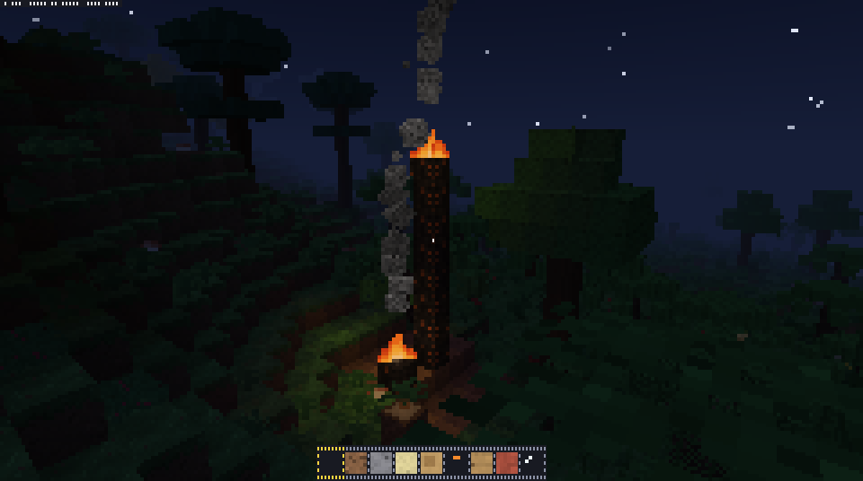

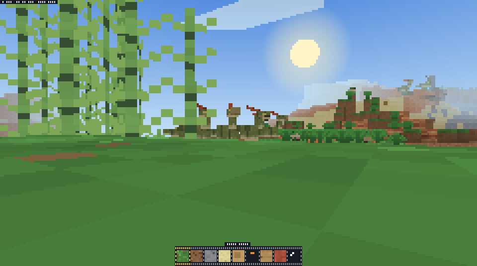

- **Quickclaws** are feathered hunters as tall as you, in packs of two or three, in survival only. They come out where it is dark, at night under the sky or in a cave, 16 to 36 blocks from you, and they go when the day comes. The first night of a world is quiet: they come from the second.
  - They run a little faster than you walk, so you cannot outrun one. A bite takes 3 points, once a second.
  - **Light holds them.** A quickclaw will not step into light: it stops about four blocks from a torch, in your hand or set down, or from a hearth that burns, and waits, and its eyes shine in the dark.
  - They hunt the herds too. With no player to go for, a quickclaw goes for the nearest bugler or nipper, and stands over a kill for a quarter of a minute. The meat is there for whoever takes it.
  - A quickclaw has 10 points of health, so a sky iron knife kills it in two hits. A hit only sets it back for a moment, unless it is badly hurt with none of its pack within ten blocks: then it runs.
  - Quickclaws are not saved, and they lose you when you faint or sleep.
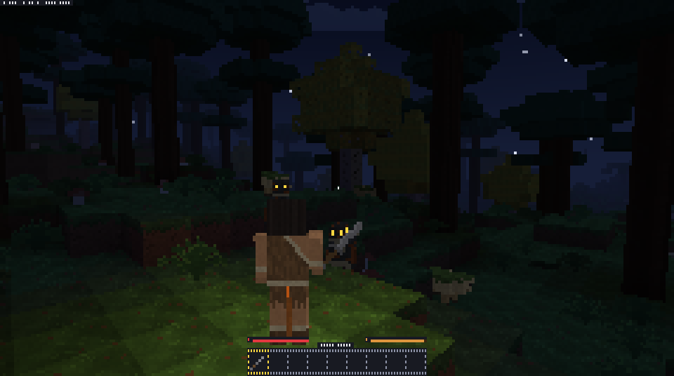

- **The dread** is the top hunter: five blocks tall and nine long, with jaws as long as you are. It is in survival only.
  - **It comes rarely, and you feel it first.** None comes before the morning of the third day. Then one comes at a time, by day or night, 70 to 86 blocks off, and the next comes a day or two after the last has gone. Its steps are heard from 90 blocks and shake your view from 60, and it roars when it has noticed you.
  - **You cannot outrun it or fight it in the open.** It runs at 6 blocks a second against your 4.3, a bite takes 8 of your 20 points, once every second and a half, and it has 200 points of health, which is 34 thrown hardened spears. It sees you from 40 blocks and hears you move from 28.
  - **You hide, or go where it cannot.** Crouched among tall ferns or horsetails it sees you only from 3 blocks, as a quickclaw does. Its body is over two blocks wide, so it cannot follow through a gap of two blocks or into a narrow cave.
  - **Only a big fire holds it.** It walks through the light of a torch or a hearth. Three or more fires burning within four blocks of each other, hearths, standing torches or a struck tree's fire, are a big fire, and it will not come within seven blocks of one.
  - **It hunts the herds.** With no player noticed it goes for the nearest beast within 32 blocks, giants too, and stands over a kill for 20 seconds. Quickclaws within 16 blocks of it run.
  - It is about for half a day, and then goes. It is not saved, and it loses you when you faint or sleep.

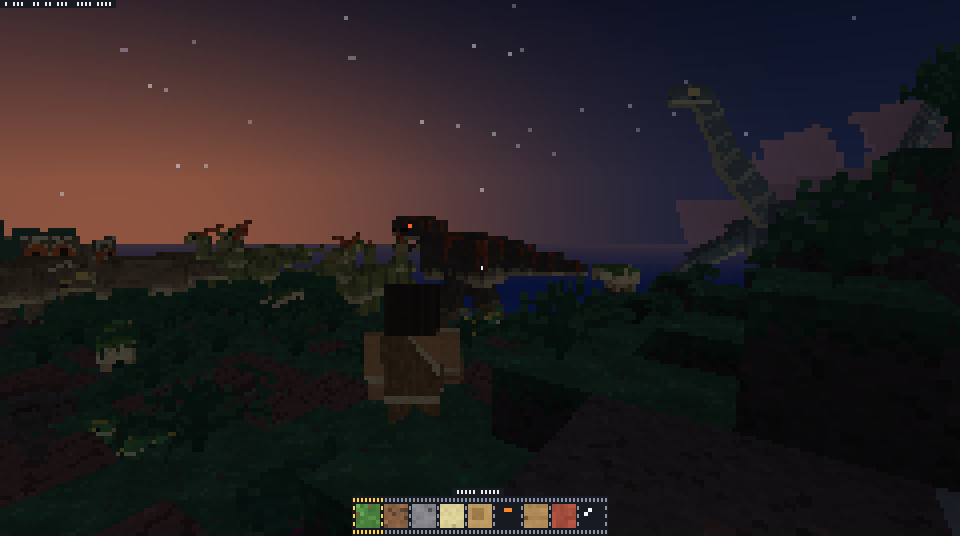

- **Pit traps.** A pit cover is a block of branches and ferns that you lay over a hole as you lay any block. It holds you, a nipper, a mossback and a quickclaw. A bugler, a giant or the dread that gets its middle onto one breaks through: the whole cover gives way at once, and the beast is tipped in.
  - **The fall hurts a heavy beast:** nothing for two blocks, then a sixth of its kind's health for each block more. A pit four deep takes a third of a dread's 200 points, and a third of a bugler's 16.
  - **It cannot climb out:** a giant climbs two blocks and a bugler one. From the rim you throw spears down, or stab: a dread in a pit four deep cannot reach you, and its head stands just over the rim.
  - **This is how the dread is killed.** It leaves 12 pieces of meat and 4 hides. Dig the pit three wide each way, as it is over two blocks wide, cover it with nine covers, and have it come at you across it.
- **Stampedes.** A herd that runs in alarm runs down what is in its way: you, as before, and now every lighter beast of another kind, for the 3 points a bugler's bump takes. A pebble from the sling makes a herd run from where it lands, so a herd can be driven over a pack of quickclaws, or into your pit.

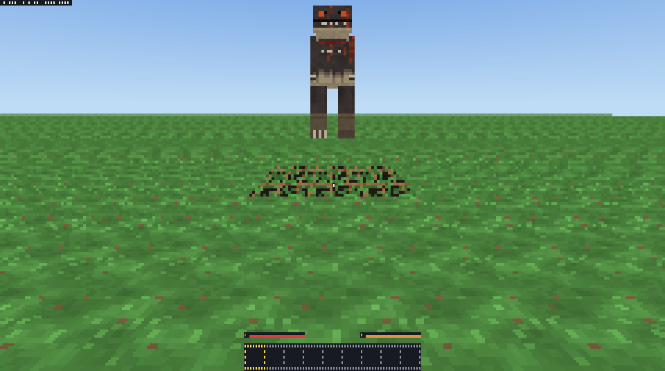

- **Hiding.** A quickclaw sees you from 20 blocks, from 10 if you crouch, and from 3 if you crouch among tall ferns or horsetails, and never through a wall. It hears you move from 14 blocks, and from 3 if you crouch. Raw meat anywhere on you doubles all of these. The line at the top of the screen says `hidden` when you are, and one that has lost you keeps looking for six seconds.
- **Fainting.** At no health you faint, and wake at your fur bed or where a new player starts, whole again and with everything you carried.
- **Creative.** Every block on the I screen, as many as you want, broken at once and dropping nothing. Nothing hurts and you can fly.
- These numbers are first guesses, to be tuned.

- A day lasts ten minutes of play, and the clock stands still in a pause. A new world starts in the morning.

## Worlds and saving

The title lists your worlds, the last played first, with how each is played and its day. Choose one to play it, or to delete it: that asks twice, and a deleted world is gone for good. **New world** asks for a name, then a seed (leave it empty for any), then how it is played.

The world is saved when you choose **Save and leave**, which goes back to the list, and also on **Quit**, Ctrl-C or when the window closes.

- A world is a folder of `skyspear/worlds` in your config folder (`~/Library/Application Support` on macOS, `~/.config` on Linux), named as you named the world; `-worlds` names another folder of worlds. It holds `world.json` (the seed, the mode, the day and the hour, where you were, what you carry, how your body is, what lies on the ground, what the pots and the hearths hold, your bed, the look you wear, and how far the torch in your hand has burned) and one small file for each chunk you changed. The rest of the world is made again from the seed.
- Every file is written beside the old one and then put in its place, so a write that fails leaves the old file.
- A world whose `world.json` cannot be read is listed as such and does not open, so it is never written over. It can still be deleted.
- `-world folder` plays the one world in that folder, with no list, as the game did before: the title offers **Continue**, **New world** asks before it takes the place of the saved world, and a `world.json` there that cannot be read stops the game with an error.
- A chunk file that cannot be read does not stop the game. The chunk is made again from the seed, a line on screen says so, and the file is never written over, so what you build in that chunk is not kept.
- **A world saved before the land turned old** (by `v0.2.0` or earlier) is listed as from an older version and does not open: some of its blocks are now other things. It is left untouched, and the game that made it still installs from its tag.
- **Worlds made under the old name** are still in `gocraft/worlds` in your config folder, untouched. `skyspear -worlds` with that folder lists them, as from an older version.
- **The one world of the first version** (`gocraft/world.sav`) cannot be played by this one. It is left where it is, untouched.
- The beasts are saved: what kind each is, where it stood, its herd and its health, and a mossback's moss, shorn or grown.

## Settings

**Settings**, on the title and the pause menu, has the mouse speed (how far a drag turns the view), the view distance (32, 48 or 64 blocks: less is a little faster), the field of view (50° to 90°) the volume (0% to 100%), and whether the view shakes at a giant's step. Left and Right, or a click, change a line. They are kept in `skyspear/settings.json` in your config folder, apart from any world, and so is the view you last chose with V.

## Flags

| Flag | Meaning |
|---|---|
| `-seed n` | the number a new world is made from, offered as its seed; the same number makes the same world. 0, the default, takes one from the clock |
| `-worlds folder` | the folder of the worlds the title lists |
| `-world folder` | play only the world in this folder, with no list |
| `-mouse=false` | leave the pointer to the terminal |
| `-mute` | play with no sound, and leave the sound device alone |
| `-shot file.png` | draw one frame of play into a PNG and quit, to look at it without a terminal. A letter is a mark in its color where it stands |

## How it is drawn

Two things draw into one frame, and glonk holds them together.

- **The blocks are rays.** Every pixel of glonk's half-block `Canvas` sends a ray through the grid of blocks and takes the color of the tile it lands on. That is quick, it lets a far block be drawn from a smaller copy of its tile so that it does not flicker, and it does water exactly: you see the bottom through it. A plant is two pictures that cross in its cell, and a fur bed one picture lying flat in its cell; the rays meet those too. The rays are the ones `Camera.RayPixels` gives, they end at the camera's `Far`, they fade by `Fog.Apply`, and they store glonk's depth with `Canvas.SetDepth`.
- **Soft shadows where blocks meet.** A face is darker toward the solid blocks beside the cell in front of it, and darkest in a corner shut on both sides. The shade is worked out at the four corners of a face, once for all the pixels on it, and blended across it; it fades out between 24 and 32 blocks away, where it can no longer be seen.
- **The things are glonk meshes.** The clouds are see-through slabs (`Material.Opacity`), a beast is a list of boxes with its picture on their faces (`Material.Texture`): six for a mossback and for a nipper and ten for a bugler, whose young are the same boxes made half the size, and twelve for a quickclaw, four of them eyes with no picture that are drawn lit in full where it is dark, a thing on the ground is a small turning cube with its block's tiles, and the bits that fly from a block you break are tiny cubes of the same. glonk lights them, fades them by the same fog, and hides them behind any block that is nearer, through the depth the rays stored. Under water that depth is the ground's, so a thing in a pool is drawn whole: the block renderer keeps the pixels it saw ground in through water, and after the beasts are drawn lays the water's color over each of those that has changed and lies deeper than the top of the water. The outline round the block you aim at is a cube's edges drawn with `DrawOnSurfacePixels`, and the cracks on a block you dig are drawn by the rays, from a picture of cracks that grow out from the middle. What you hold is drawn last, with a camera of its own, low on the right: a block as a small block, and a tool as its picture on a plate whose holes are `Material.Texture` holes. It is drawn so near that its depth is less than any block's can be, so it never sinks into a wall.
- **Your body is glonk meshes too, and the camera steps back to see it.** A cave person is six boxes with a picture on their faces: a head that tips with your view, a trunk, and arms and legs that swing as you walk. From behind, the camera sits four blocks back from a point at your right shoulder, along the way you look, so your body does not hide what you aim at. A ray from that point stops the camera short of the first solid block, so it never looks through a wall, and with less than a block of room behind you the eyes see instead. What you aim at is what the crosshair or the pointer shows: the camera's ray, begun where it passes you, so nothing behind your back is aimed at and your reach stays your body's.
- **Light is worked out once, not per pixel.** Each cell holds a level from 0 to 15 of light from the sky and one of light from fires, torches and glowing crystal, and a face is drawn as bright as the cell in front of it. The hour then says how bright and what color each level looks: white by day, warm at sunset, dim blue by night, and always warm by a torch. The creatures are lit by the cell they stand in, and the clouds by the hour.

On one core of an Apple M5 Pro, at 240 by 134 pixels, the blocks take 2.5 to 4 ms, the clouds 0.3 ms, twelve mossbacks 0.1 ms and thirty beasts of both kinds 0.3 ms; a whole frame with the HUD 5 ms. The soft shadows add under 0.2 ms. At 400 by 110 cells a frame takes 13 ms, well inside the 33 ms of a frame at 30 a second, so the rays run on one core.

## A world with no end

The rays look up millions of blocks a frame, so a block has to be one index into one list. The world is therefore not a map of pieces: only the part round you is held, in a window of 256 by 256 columns that slides with you. A block at `x, z` lives at `x & 255, z & 255`, so the list wraps round and nothing is copied when the window moves.

The world is made a chunk at a time, 16 by 16 columns and 128 high, each from the seed and its place alone. So a chunk is the same whenever it is made, a tree on the line between two chunks is built half by each, and only the chunks you changed need saving. A chunk takes 0.2 ms to make and they come in two a frame, the nearest first, which keeps ahead of flying flat out. The widest tree, a redwood, reaches five blocks from its foot, so a chunk looks that far outside itself for trees.

Four slow noises say how high the land stands, how rough it is, how warm and how wet, and from those each column is sea, shore, prairie, jungle, highland, badlands, steppe, crags or swamp. The swamp is not a height the land happens to have: where the country is wet enough and stands low enough, its ground is drawn down to just over the sea, the more the farther inside both, so that the land round a swamp comes down to it and does not end in a cliff. Caves and ores come from noise in three dimensions, worked out on a coarse grid that is the same for the whole world.

A thing bigger than a chunk cannot be built by one. So the ground is also cut into squares of 160 blocks, and the seed gives each square one landmark or none, well inside it. A chunk asks only about the squares it lies in and builds its part from the seed alone. A tar pit is such a landmark too, in some squares of the swamp and the badlands that hold no skeleton. The first landmark is a great skeleton: a skull, ribs that stand as arches you can walk under, and a tail. Most lie in the badlands and a few on the prairie. The second is a tree that lightning struck, in seven of ten of the squares of dry land that hold no skeleton: so the game can ask the seed where the fires near you are, and let them smoke, without looking through the blocks for them.

A fire mountain is far bigger than any landmark, so it is not put down on the land: it is part of the land. The squares of a coarser grid, 1,600 blocks wide, hold one each, and the function that says how high the ground of a column is adds the mountain's cone to it, and its crater. So a chunk on the mountain is made from the seed and its place alone, as every chunk is, and it costs a chunk off the mountain nothing that can be measured: 0.190 ms before and after. Its hot springs and its lava tube are placed by the seed from the mountain's own place, so a chunk builds its part of each as it builds its part of the cone. A geyser spouts by the clock of the world, each at its own moment of a round of 30 seconds, so nothing of it is in a save. An eruption is by the seed and the clock too: the seed gives a mountain the days between one eruption and the next, so a world saved half way through one goes on with it when it is opened. A burning rock is one more row of the table of thrown things, with its own landing. All a save holds of an eruption is the fires the rocks left, each with the seconds it still burns.

A falling star is by the seed too: the seed says of each night whether one falls and at what part of the night. It is one more row of the table of thrown things, but the sky draws it and not the land: where the fireball is, and where the end of its tail is, are given to the sky as two ways from the eye, as the smoke of a mountain is. Shooting stars are worked out by the sky from the clock alone. What a save keeps is what burns for a time and then changes, as the fires of an eruption do: each fire of a crater, which goes out, and its core, which goes dark.

The comet is one number, how near it is, which the game works out from the day and gives the sky: so nothing of it is in a save. The sky fixes it among the stars, on the line from the point they turn about to the top of the sky at midnight, and draws its head and its tail from that number. How many shooting stars there are is worked out once for each night, as the sky finds which streak is in it from the clock and that number, and a number that changed through the night would make them jump.

The Great Fall is by the clock too: it begins a minute and a half before the midnight the comet arrives, and how far it has got is the day and nothing else. So a world saved in the middle of it goes on with it when it is opened, one opened after it does not see it twice, and a save holds no word of it. Its stars are the lone star of other nights, let fall every two seconds. The sky shows up to four fireballs at once. The white of the Skyspear's own strike is laid over the whole picture, as the red of a hurt is.

The winter is by the clock as well: four days from the strike. Its frost is one number given to the block renderer, which draws the top of a block paler where the cell over it has the full light of the sky. So the world is not touched, a save is no bigger, and in spring the ground is as it was. Warmth is kept in a save as what has been lost of it, so an older save, which says nothing, is whole. Thin herds are the table's own numbers halved, and a bold hunter is one that is asked how bright a fire is where it stands, and not how bright the day.

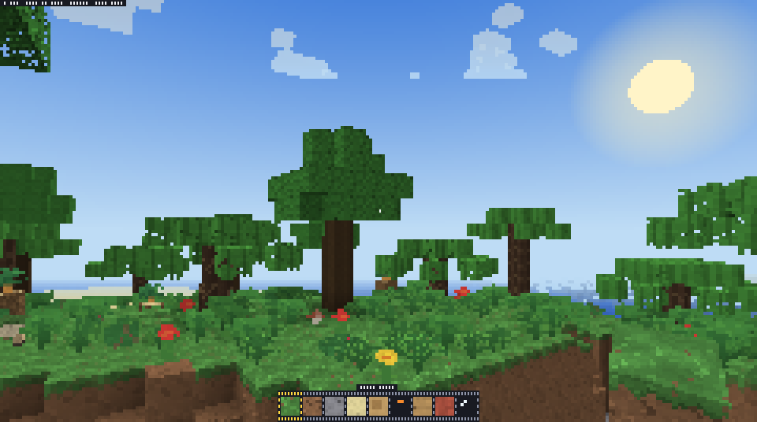

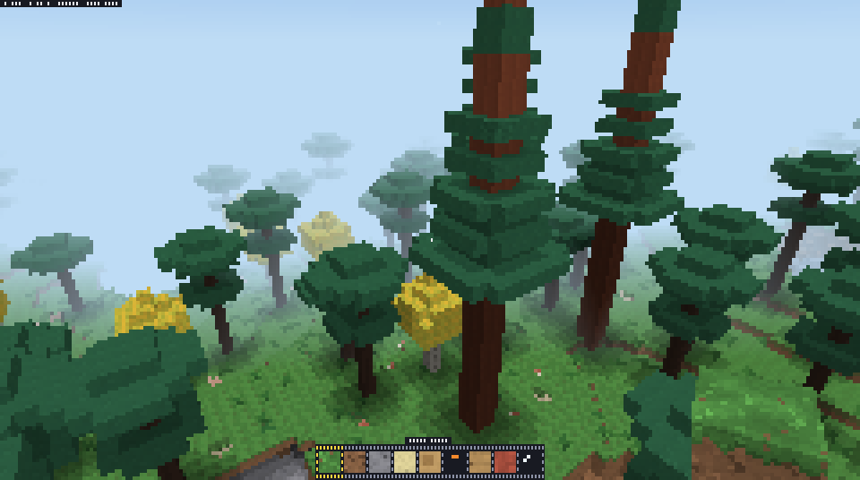

## Light

Light from the sky falls straight down to the first block that stops it, dimmed a level by each leaf or water block on the way. From there light, and the light of a torch, loses a level for each step it takes, so it spreads under an overhang, round a corner and down a shaft, and is gone 15 steps from where it was full. The torch in your hand is one more light, in the cell your head is in, and the light round it is worked out again when you step into another cell, which costs a quarter of a millisecond. This is worked out by a flood fill over the window, which holds one byte of light beside each block:

- **When a chunk comes in**, its own light spreads into the chunks beside it and theirs into it. Light only goes up then, so the order chunks come in does not matter. It takes 0.05 ms beside the 0.2 ms of making the chunk.
- **When you change a block**, the light is worked out again in the box round it that the change can reach: 14 blocks every way, and down the column under it, whose sky it may open or shut. It takes 0.2 ms.
- Light is not saved. It is worked out again from the blocks when the world loads.

Tests check the light against a plain, slow flood fill: in chunks of jumbled blocks that come in in any order, after random changes, and across the edges of chunks.

glonk also runs the loop and the terminal, reads the keys, the mouse and what is typed or pasted for a name (`Input.Text`, `Input.Paste`), draws the title picture (`bitmap`), the menus, the HUD and the health and food bars (`widget`), puts the pictures of the hotbar and the bag down over their panels (`Canvas.ComposeRect`), reports the frame numbers (`Stats`), draws the `-shot` picture (`FrameBuffer.Image`), and runs every test without a terminal.

## Sound

Every sound is heard from where it is made: quieter the farther it is, gone at 24 blocks, and louder in the ear on its side. A bugler's voice carries three times as far, so you hear a herd before you see it. Your steps sound as the ground you walk on, and digging, breaking and placing as the block, in seven kinds: earth, stone, sand, wood, plants, glass and snow. You hear water you fall into, what you pick up or make, being hurt and eating; mossbacks to themselves and when hit, the long horn of a bugler and the two blasts of its alarm, the chirp of a nipper, the low growl of a quickclaw and the screech it gives when it has seen you, the grunt of a giant at its feed, the bellow of a shieldbrow and the rattle of a thornback's plates, the long low drone of a cloudgrazer and the thud of a giant's step, the rumble of the dread's breath and its roar, the fire of a hearth or of a struck tree, the rush of a geyser, the rumble of a fire mountain that is about to erupt and the thud of each rock it throws, the boom of a star that struck, the trumpet of a snowtusk, the howl of a pack and the snarl of a daggercat, the whirr of a rattlewing, the hiss of a sunback or a sailjaw, and water dripping in caves. Under all of it the wind blows as much as the sky reaches you, and fades into the low air of a cave where it does not.

A small mixer of the game's own plays up to 16 sounds at once, each a little higher or lower at random so that steps do not sound the same, bends the loudest moments so that many at once do not crack, and brings the wind and the cave air up and down slowly. [oto](https://github.com/ebitengine/oto) v3.5.1 plays what it makes, with no C compiler needed on macOS, Linux or Windows. With no sound device the game plays on in silence and the title says why. On Linux oto plays through PulseAudio, which PipeWire also serves.

The sounds are made by code too, as WAV files in `internal/assets/sound`, so each can be listened to on its own:

```
make assets                                   # make them again, with the pictures
afplay internal/assets/sound/step-wood.wav    # listen to one, on a Mac
```

## Pictures

`internal/assets/img` holds the seven pictures the game uses: a strip of 96 tiles (the blocks', the cracks', and the pictures of the things that are not blocks: tools, blades, bars, food and the rest), the title, the mossback's six tiles, the bugler's seven, the nipper's four, the quickclaw's five, and the cave person's seven in each of six looks. All are drawn by `cmd/genassets` from a fixed hash, so they come out the same every time:

```
make assets                                   # draw them again
go run ./cmd/genassets -preview sheet.png     # and an enlarged sheet to look at
```

A test fails if the pictures in the repo are not what the generator draws.

## Development

```
make check    # formatting, vet, and tests with the race detector
make bench    # the time to draw the blocks, the clouds, the beasts and a whole frame
```

The race detector needs cgo. Where there is no C compiler, run `make check RACE=`.

| Package | Purpose |
|---|---|
| `internal/world` | the blocks round the player in a sliding window and their light, the land a seed makes, rays through the grid, items, saved worlds |
| `internal/render` | the blocks drawn by rays into a glonk `Canvas`, the sky at each hour, and the clouds, beasts, cave people and things on the ground drawn into it as glonk meshes |
| `internal/game` | the game glonk runs: the player and its body, the view from behind it, the table of beasts and how each kind lives, digging and building, what is carried and what is made from it, the mouse, the HUD, the bag, the list of worlds, the settings, the title and pause menus, and what makes a sound when |
| `internal/sound` | the names of the sounds, the mixer that places each in the world, and the speaker that plays it with oto |
| `internal/assets` | the pictures and the sounds, read once at start-up, each block tile in five sizes |
| `internal/tile` | the names of the tiles in the strip |
| `cmd/genassets` | draws the pictures and makes the sounds |

Skyspear uses glonk v0.12.0, and oto v3.5.1 for sound.

## Not in yet

- Flowing water, and shadows cast to the side by the sun: its light falls straight down.
- Soft shadows from leaves and glass: only blocks that let no light through cast them.
- Torches on walls: a torch stands on the ground, as a plant does.
- Anything a tame mossback does for you but follow: carrying comes later.
- Ash that falls and lies on the ground.
- A rock of an eruption comes down only where the world is loaded, about 100 blocks round you: what you were too far off to see left nothing.
- A use for crystal, for tusks and for amber.
- Snow that falls and lies as blocks, and ice on the sea in the winter.
- Clothes other than the cloak, and a place to wear them.
- Beasts of the sea: that is the next step. Then beasts of the sky.
- A star falls only where the world is loaded, about 100 blocks round you: there are no craters where you were not.
- Lava that flows.
- A beast that digs or climbs out of a pit. The dread in one is let go when its time is up, as anywhere.
- A giant's tail has no reach past its length: a thornback or a boulderback can be speared from beyond it at no risk.
- A thrown thing that hits you, or that a beast throws: only the player throws.
- Fire that spreads, a torch that goes out in water, and beasts that fear a fire as such: quickclaws keep out of its light.
- The I screen needs a terminal about 25 rows tall in creative, and 21 rows tall and 90 columns wide in survival; a hearth needs 25 rows, and a clay pot 29.
- A clay pot or a hearth does not open in creative, where every block is at hand.
- A view that follows the mouse without a button held.
- A view of your body from the front, and its own way of standing when it swims or flies.
- Hiding from anything when you crouch: nothing looks for you yet.
- Music, and sounds that echo in a cave or are muffled behind a wall.
- Renaming a world, or making a copy of one.

## License

MIT. See [LICENSE](LICENSE).
